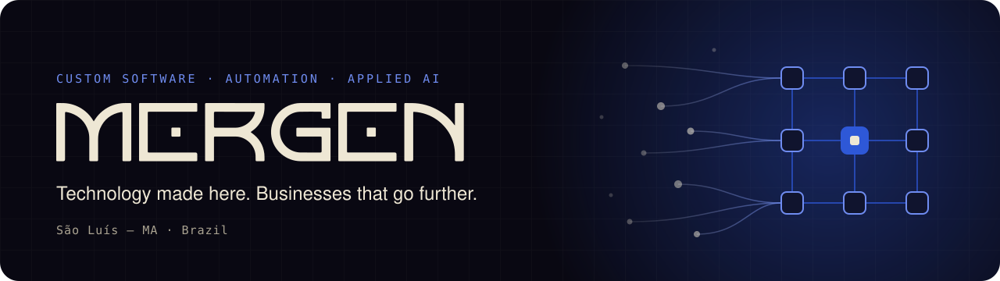

  

  
  
  

  <b>Custom software, automation, and AI for businesses that want results — not generic tools.</b> 
  You talk directly to the people who build it. Fewer handoffs, less noise.

🇧🇷 Versão em português no final da página.

---

## Routines that become systems

We connect WhatsApp, spreadsheets, documents, schedules, and operating rules to turn scattered tasks into intelligent, dependable structures.

| ⚙️ Process automation | `</>` Custom software | ✦ Applied AI |
| :-- | :-- | :-- |
| We connect repetitive tasks, systems, and information to eliminate rework and reduce errors. | Technology designed around how your business actually operates — today and in the future. | Intelligence used where it improves decisions, anticipates priorities, and optimizes routines. |

## How we work

| 1 · Understand | 2 · Prioritize | 3 · Build | 4 · Evolve |
| :-- | :-- | :-- | :-- |
| We dive into the context, listen to the people living the routine, and map what matters. | We define what creates the greatest impact, using data and the team's experience. | We develop robust, integrated solutions designed for real use. | We follow results, adjust, and expand as the business grows. |

## Selected work

| Client | What we built | Result |
| :-- | :-- | :-- |
| **Castro Advocacia**  Law practice | An integrated legal organizer mapping clients, cases, deadlines, finances, and documents. | One centralized environment, with automations that cut manual work and give the team more control. |
| **Dr. Exercício**  Fitness franchise network | A franchise management system plus a workout app for students and staff. | Standardized operations across units and a connected student journey. |
| **D&A Naturais**  Document-heavy operation | A platform that generates contracts, reports, proposals, and forms from templates and personalization rules. | Fewer inconsistencies, less rework, and hours saved on manual document assembly. |
| **Busca Terra**  Front-end outsourcing | On-demand front-end development with shared interface, responsiveness, and API integration standards. | Modern, scalable interfaces delivered faster, with consistent visual and technical quality. |

## Products

<table>
  <tr>
    <td width="50%" valign="top">
      <h3>🐾 Petscription</h3>
      
<b>Connected pet care.</b> Medications, schedules, and pet information organized to make daily care easier for pet owners.

      
Mobile &amp; web · In development

      
<a href="https://mergenst.com.br/en/petscription">Visit the website →</a>

    </td>
    <td width="50%" valign="top">
      <h3>💌 Qonvite</h3>
      
<b>Guest management for private events.</b> Personalized invitations, RSVP, guest organization, and QR code check-in in one workflow.

      
In development

      
<a href="https://mergenst.com.br/en">Learn more →</a>

    </td>
  </tr>
</table>

## Stack

| Area | Technologies |
| :-- | :-- |
| **Backend** | ![Python][python] ![Django][django] ![FastAPI][fastapi] ![Node.js][node] ![Go][go] |
| **Database** | ![PostgreSQL][postgres] ![Redis][redis] |
| **Frontend** | ![TypeScript][ts] ![React][react] ![Next.js][next] ![Tailwind CSS][tailwind] |
| **Mobile** | ![React Native][react-native] |
| **Desktop** | ![Tauri][tauri] |
| **AI** | ![OpenAI][openai] ![Claude][claude] |
| **Infra & security** | ![Docker][docker] ![AWS][aws] ![Cloudflare][cloudflare] ![Keycloak][keycloak] ![On-premises][onprem] |

## Let's talk

**Which routine is holding your business back?** Tell us the problem — we'll show where automation, software, or AI can make a difference.

📍 São Luís — Maranhão, Brazil · ✉️ [contato@mergenst.com.br](mailto:contato@mergenst.com.br) · 🌐 [mergenst.com.br](https://mergenst.com.br) · 📷 [@mergen.st](https://www.instagram.com/mergen.st/)

---

<b>🇧🇷 Leia em português</b>

 

**Software sob medida, automação e IA para negócios que querem resultado — não ferramentas genéricas.**
Você fala direto com quem constrói. Menos repasse, menos ruído.

### Rotinas que viram sistemas

A Mergen conecta WhatsApp, planilhas, documentos, agendas e regras operacionais para transformar tarefas soltas em estruturas inteligentes e confiáveis.

| ⚙️ Automação de processos | `</>` Software sob medida | ✦ IA aplicada |
| :-- | :-- | :-- |
| Conectamos tarefas repetitivas, sistemas e informações para eliminar retrabalho e reduzir erros. | Tecnologia desenhada em torno de como o seu negócio realmente opera, hoje e no futuro. | Inteligência usada onde melhora decisões, antecipa prioridades e otimiza a rotina. |

### Como trabalhamos

| 1 · Entender | 2 · Priorizar | 3 · Construir | 4 · Evoluir |
| :-- | :-- | :-- | :-- |
| Mergulhamos no contexto, ouvimos quem vive a rotina e mapeamos o que importa. | Definimos o que gera mais impacto com base em dados e na experiência do time. | Desenvolvemos soluções robustas, integradas e pensadas para uso real. | Acompanhamos resultados, ajustamos e expandimos conforme o negócio cresce. |

### Projetos

| Cliente | O que construímos | Resultado |
| :-- | :-- | :-- |
| **Castro Advocacia**  Escritório de advocacia | Um organizador jurídico integrado com clientes, processos, prazos, financeiro e documentos. | Um ambiente único, com automações que reduzem tarefas manuais e dão mais controle à equipe. |
| **Dr. Exercício**  Rede de franquias fitness | Sistema de gestão da franquia e aplicativo de treinos para alunos e equipe. | Operação padronizada entre as unidades e jornada do aluno conectada. |
| **D&A Naturais**  Operação com muitos documentos | Plataforma que gera contratos, relatórios, propostas e formulários a partir de modelos e regras de personalização. | Menos inconsistências, menos retrabalho e menos tempo na montagem manual de documentos. |
| **Busca Terra**  Outsourcing de front-end | Desenvolvimento front-end sob demanda com padrões de interface, responsividade e integração com APIs. | Interfaces modernas e escaláveis, entregues com mais agilidade e consistência visual e técnica. |

### Produtos

- **🐾 Petscription — Cuidado pet conectado.** Medicamentos, horários e informações do pet organizados para facilitar a rotina de quem cuida. Mobile e web · Em desenvolvimento · [Acessar o site →](https://mergenst.com.br/en/petscription)
- **💌 Qonvite — Gestão de convidados.** Convite personalizado, organização de convidados, RSVP e check-in por QR Code em um mesmo fluxo para eventos privados. Em desenvolvimento

### Vamos conversar

**Qual rotina está travando o seu negócio?** Conte o problema. A Mergen mostra onde automação, software ou IA podem fazer diferença.

📍 São Luís — Maranhão · ✉️ [contato@mergenst.com.br](mailto:contato@mergenst.com.br) · 🌐 [mergenst.com.br/pt-BR](https://mergenst.com.br/pt-BR) · 📷 [@mergen.st](https://www.instagram.com/mergen.st/)

<b>Mergen</b> · Technology for those who want to go further.

<!-- Stack badges -->
[python]: https://img.shields.io/badge/Python-241B4B?style=flat-square&logo=python&logoColor=white
[django]: https://img.shields.io/badge/Django-241B4B?style=flat-square&logo=django&logoColor=white
[fastapi]: https://img.shields.io/badge/FastAPI-241B4B?style=flat-square&logo=fastapi&logoColor=white
[node]: https://img.shields.io/badge/Node.js-241B4B?style=flat-square&logo=nodedotjs&logoColor=white
[ts]: https://img.shields.io/badge/TypeScript-241B4B?style=flat-square&logo=typescript&logoColor=white
[go]: https://img.shields.io/badge/Go-241B4B?style=flat-square&logo=go&logoColor=white
[postgres]: https://img.shields.io/badge/PostgreSQL-241B4B?style=flat-square&logo=postgresql&logoColor=white
[redis]: https://img.shields.io/badge/Redis-241B4B?style=flat-square&logo=redis&logoColor=white
[react]: https://img.shields.io/badge/React-241B4B?style=flat-square&logo=react&logoColor=white
[next]: https://img.shields.io/badge/Next.js-241B4B?style=flat-square&logo=nextdotjs&logoColor=white
[tailwind]: https://img.shields.io/badge/Tailwind_CSS-241B4B?style=flat-square&logo=tailwindcss&logoColor=white
[react-native]: https://img.shields.io/badge/React_Native-241B4B?style=flat-square&logo=react&logoColor=white
[tauri]: https://img.shields.io/badge/Tauri-241B4B?style=flat-square&logo=tauri&logoColor=white
[openai]: https://img.shields.io/badge/OpenAI-241B4B?style=flat-square&logo=data:image/svg%2bxml;base64,PHN2ZyBmaWxsPSJ3aGl0ZSIgcm9sZT0iaW1nIiB2aWV3Qm94PSIwIDAgMjQgMjQiIHhtbG5zPSJodHRwOi8vd3d3LnczLm9yZy8yMDAwL3N2ZyI+PHRpdGxlPk9wZW5BSTwvdGl0bGU+PHBhdGggZD0iTTIyLjI4MTkgOS44MjExYTUuOTg0NyA1Ljk4NDcgMCAwIDAtLjUxNTctNC45MTA4IDYuMDQ2MiA2LjA0NjIgMCAwIDAtNi41MDk4LTIuOUE2LjA2NTEgNi4wNjUxIDAgMCAwIDQuOTgwNyA0LjE4MThhNS45ODQ3IDUuOTg0NyAwIDAgMC0zLjk5NzcgMi45IDYuMDQ2MiA2LjA0NjIgMCAwIDAgLjc0MjcgNy4wOTY2IDUuOTggNS45OCAwIDAgMCAuNTExIDQuOTEwNyA2LjA1MSA2LjA1MSAwIDAgMCA2LjUxNDYgMi45MDAxQTUuOTg0NyA1Ljk4NDcgMCAwIDAgMTMuMjU5OSAyNGE2LjA1NTcgNi4wNTU3IDAgMCAwIDUuNzcxOC00LjIwNTggNS45ODk0IDUuOTg5NCAwIDAgMCAzLjk5NzctMi45MDAxIDYuMDU1NyA2LjA1NTcgMCAwIDAtLjc0NzUtNy4wNzI5em0tOS4wMjIgMTIuNjA4MWE0LjQ3NTUgNC40NzU1IDAgMCAxLTIuODc2NC0xLjA0MDhsLjE0MTktLjA4MDQgNC43NzgzLTIuNzU4MmEuNzk0OC43OTQ4IDAgMCAwIC4zOTI3LS42ODEzdi02LjczNjlsMi4wMiAxLjE2ODZhLjA3MS4wNzEgMCAwIDEgLjAzOC4wNTJ2NS41ODI2YTQuNTA0IDQuNTA0IDAgMCAxLTQuNDk0NSA0LjQ5NDR6bS05LjY2MDctNC4xMjU0YTQuNDcwOCA0LjQ3MDggMCAwIDEtLjUzNDYtMy4wMTM3bC4xNDIuMDg1MiA0Ljc4MyAyLjc1ODJhLjc3MTIuNzcxMiAwIDAgMCAuNzgwNiAwbDUuODQyOC0zLjM2ODV2Mi4zMzI0YS4wODA0LjA4MDQgMCAwIDEtLjAzMzIuMDYxNUw5Ljc0IDE5Ljk1MDJhNC40OTkyIDQuNDk5MiAwIDAgMS02LjE0MDgtMS42NDY0ek0yLjM0MDggNy44OTU2YTQuNDg1IDQuNDg1IDAgMCAxIDIuMzY1NS0xLjk3MjhWMTEuNmEuNzY2NC43NjY0IDAgMCAwIC4zODc5LjY3NjVsNS44MTQ0IDMuMzU0My0yLjAyMDEgMS4xNjg1YS4wNzU3LjA3NTcgMCAwIDEtLjA3MSAwbC00LjgzMDMtMi43ODY1QTQuNTA0IDQuNTA0IDAgMCAxIDIuMzQwOCA3Ljg3MnptMTYuNTk2MyAzLjg1NThMMTMuMTAzOCA4LjM2NCAxNS4xMTkyIDcuMmEuMDc1Ny4wNzU3IDAgMCAxIC4wNzEgMGw0LjgzMDMgMi43OTEzYTQuNDk0NCA0LjQ5NDQgMCAwIDEtLjY3NjUgOC4xMDQydi01LjY3NzJhLjc5Ljc5IDAgMCAwLS40MDctLjY2N3ptMi4wMTA3LTMuMDIzMWwtLjE0Mi0uMDg1Mi00Ljc3MzUtMi43ODE4YS43NzU5Ljc3NTkgMCAwIDAtLjc4NTQgMEw5LjQwOSA5LjIyOTdWNi44OTc0YS4wNjYyLjA2NjIgMCAwIDEgLjAyODQtLjA2MTVsNC44MzAzLTIuNzg2NmE0LjQ5OTIgNC40OTkyIDAgMCAxIDYuNjgwMiA0LjY2ek04LjMwNjUgMTIuODYzbC0yLjAyLTEuMTYzOGEuMDgwNC4wODA0IDAgMCAxLS4wMzgtLjA1NjdWNi4wNzQyYTQuNDk5MiA0LjQ5OTIgMCAwIDEgNy4zNzU3LTMuNDUzN2wtLjE0Mi4wODA1TDguNzA0IDUuNDU5YS43OTQ4Ljc5NDggMCAwIDAtLjM5MjcuNjgxM3ptMS4wOTc2LTIuMzY1NGwyLjYwMi0xLjQ5OTggMi42MDY5IDEuNDk5OHYyLjk5OTRsLTIuNTk3NCAxLjQ5OTctMi42MDY3LTEuNDk5N1oiLz48L3N2Zz4=
[claude]: https://img.shields.io/badge/Claude-241B4B?style=flat-square&logo=claude&logoColor=white
[docker]: https://img.shields.io/badge/Docker-241B4B?style=flat-square&logo=docker&logoColor=white
[aws]: https://img.shields.io/badge/AWS-241B4B?style=flat-square&logo=data:image/svg%2bxml;base64,PHN2ZyBmaWxsPSJ3aGl0ZSIgdmlld0JveD0iMCAwIDI0IDI0IiB4bWxucz0iaHR0cDovL3d3dy53My5vcmcvMjAwMC9zdmciPjxwYXRoIGQ9Ik02Ljc2IDEwLjAzYzAgLjI5Ni4wMy41MzUuMDguNzEuMDYuMTc2LjE0LjM2OC4yNS41NzYuMDQuMDYuMDU2LjEyLjA1Ni4xOCAwIC4wOC0uMDQ4LjE2LS4xNTIuMjRsLS41MDMuMzNhLjM4My4zOCAwIDAgMS0uMjA4LjA3Yy0uMDggMC0uMTYtLjA0LS4yMzktLjExMmEyLjQ3IDIuNDcgMCAwIDEtLjI4Ny0uMzc1IDYuMTggNi4xOCAwIDAgMS0uMjQ4LS40NzFjLS42MjIuNzMtMS40MCAxLjEwLTIuMzQgMS4xMC0uNjcgMC0xLjIwLS4xOTEtMS41OS0uNTc0LS4zOTEtLjM4NC0uNTktLjg5NC0uNTktMS41MyAwLS42NzguMjMtMS4yMy43Mi0xLjY0LjQ4Ny0uNDE1IDEuMTMtLjYyMyAxLjk1LS42MjMuMjcgMCAuNTUxLjAyLjg0Ni4wNi4yOTYuMDQuNi4xMC45MTguMTd2LS41ODNjMC0uNjA3LS4xMjctMS4wMy0uMzc1LTEuMjctLjI1NS0uMjQ4LS42ODYtLjM2Ny0xLjMtLjM2Ny0uMjggMC0uNTY4LjAzLS44NjMuMTAtLjI5NS4wNy0uNTgzLjE2LS44NjIuMjdhMi4yOCAyLjI4IDAgMCAxLS4yOC4xMC40ODguNDggMCAwIDEtLjEyNy4wMmMtLjExMiAwLS4xNjgtLjA4LS4xNjgtLjI0N3YtLjM5MWMwLS4xMjguMDEtLjIyNC4wNS0uMjhhLjU5Ny41OSAwIDAgMSAuMjI0LS4xNjdjLjI3OS0uMTQ0LjYxLS4yNjQgMS4wMC0uMzZhNC44NCA0Ljg0IDAgMCAxIDEuMjQtLjE1MWMuOTUgMCAxLjY0LjIxNiAyLjA5LjY0Ny40My40My42NiAxLjA4LjY2MiAxLjk2djIuNTh6bS0zLjI0IDEuMjFjLjI2MyAwIC41MzQtLjA0OC44Mi0uMTQ0LjI4LS4wOTYuNTQtLjI3MS43NS0uNTEuMTItLjE1Mi4yMi0uMzIuMjctLjUxMi4wNC0uMTkxLjA4LS40MjMuMDgtLjY5NHYtLjMzNWE2LjY2IDYuNjYgMCAwIDAtLjczNS0uMTM2IDYuMDIgNi4wMiAwIDAgMC0uNzUtLjA0OGMtLjUzNSAwLS45MjYuMTAtMS4xOS4zMi0uMjYzLjIxLS4zOS41MS0uMzkuOTEgMCAuMzc1LjA5LjY1NS4yOS44NDYuMTkuMi40Ny4yOS44MzguMjl6bTYuNDEuODZjLS4xNDQgMC0uMjQtLjAyNC0uMzA0LS4wOC0uMDY0LS4wNDgtLjEyLS4xNi0uMTY4LS4zMTFMNy41OCA1LjU1YTEuMzkgMS4zOSAwIDAgMS0uMDcyLS4zMmMwLS4xMjguMDYtLjIuMTktLjJoLjc4M2MuMTUxIDAgLjI1NS4wMi4zMS4wOC4wNi4wNDguMTEuMTYuMTYuMzFsMS4zNCA1LjI4IDEuMjQtNS4yOGMuMDQtLjE2LjA4LS4yNjQuMTUtLjMxMmEuNTQ5LjU0IDAgMCAxIC4zMi0uMDhoLjYzOGMuMTUyIDAgLjI1Ni4wMi4zMi4wOC4wNi4wNDguMTIuMTYuMTUuMzEybDEuMjYgNS4zNCAxLjM4LTUuMzRjLjA0OC0uMTYuMTAtLjI2NC4xNi0uMzEyYS41Mi41MiAwIDAgMSAuMzExLS4wOGguNzQzYy4xMjcgMCAuMi4wNi4yLjIgMCAuMDQtLjAwOS4wOC0uMDE3LjEyYTEuMTMgMS4xMyAwIDAgMS0uMDU2LjJsLTEuOTIgNi4xN2MtLjA0OC4xNi0uMTA0LjI2LS4xNjguMzFhLjUxLjUxIDAgMCAxLS4zMDMuMDhoLS42ODdjLS4xNTEgMC0uMjU1LS4wMjQtLjMyLS4wOC0uMDYzLS4wNTYtLjExOS0uMTYtLjE1LS4zMmwtMS4yMy01LjE0LTEuMjMgNS4xNGMtLjA0LjE2LS4wODcuMjYtLjE1LjMyLS4wNjUuMDUtLjE3Ny4wOC0uMzIuMDh6bTEwLjI1LjIxNWMtLjQxNSAwLS44My0uMDQ4LTEuMjItLjE0My0uMzk5LS4wOTYtLjcxLS4yLS45MTgtLjMyLS4xMjgtLjA3MS0uMjE1LS4xNTEtLjI0Ny0uMjIzYS41NjMuNTYgMCAwIDEtLjA0OC0uMjI0di0uNDA3YzAtLjE2Ny4wNi0uMjQ3LjE4LS4yNDcuMDQgMCAuMDk2LjAwLjE0NC4wMi4wNDguMDEuMTIuMDQuMi4wOC4yNy4xMi41Ni4yMTUuODcuMjc5LjMxLjA2NC42My4wOS45NS4wOS41MDIgMCAuODk0LS4wODggMS4xNi0uMjY0YS44Ni44NiAwIDAgMCAuNDE1LS43NTguNzcuNzc3IDAgMCAwLS4yMTUtLjU1OWMtLjE0NC0uMTUxLS40MTYtLjI4Ny0uODA3LS40MTVsLTEuMTUtLjM2Yy0uNTgzLS4xODMtMS4wMS0uNDU0LTEuMjctLjgxM2ExLjkwIDEuOTAgMCAwIDEtLjQtMS4xNWMwLS4zMzUuMDctLjYzLjIxLS44ODYuMTQtLjI1NS4zMy0uNDc5LjU3LS42NTQuMjQtLjE4NC41MS0uMzIuODMtLjQxNS4zMi0uMDk2LjY1LS4xMzYgMS4wMC0uMTM2LjE3IDAgLjM1OS4wMC41MzUuMDMuMTgzLjAyLjM1LjA1LjUxOC4wOC4xNi4wNC4zMS4wOC40NS4xMjcuMTQuMDQ4LjI1LjA5Ni4zMy4xNDRhLjY5LjY5IDAgMCAxIC4yNC4yLjQzLjQzIDAgMCAxIC4wNzEuMjZ2LjM3NWMwIC4xNjgtLjA2NC4yNS0uMTg0LjI1YS44My44MyAwIDAgMS0uMzAzLS4wOTYgMy42NSAzLjY1IDAgMCAwLTEuNTMtLjMxMWMtLjQ1NSAwLS44MTUuMDctMS4wNi4yMjMtLjI0OC4xNS0uMzc1LjM4LS4zNzUuNzEgMCAuMjI0LjA4LjQxLjI0LjU2LjE1OS4xNS40NTQuMzAuODc3LjQ0bDEuMTMuMzU4Yy41NzQuMTguOTkuNDQgMS4yMy43NjcuMjQuMzI3LjM2LjcwMi4zNiAxLjExIDAgLjM0My0uMDcyLjY1LS4yMDcuOTItLjE0NC4yNy0uMzM2LjUxLS41ODMuNzAtLjI0OC4yLS41NDMuMzQtLjg4Ni40NC0uMzYuMTEtLjczNC4xNi0xLjE0LjE2N3pNMjEuNjkgMTYuMjBjLTIuNjIgMS45NC02LjQ0IDIuOTYtOS43MiAyLjk2LTQuNTkgMC04Ljc0LTEuNy0xMS44Ny00LjUyLS4yNDctLjIyMy0uMDI0LS41MjcuMjctLjM1MSAzLjM4IDEuOTYgNy41NSAzLjE1IDExLjg3IDMuMTUgMi45MSAwIDYuMTEtLjYwNyA5LjA2LTEuODUuNDM5LS4yLjgxLjI4Ny4zOC42MDd6TTIyLjc5IDE0Ljk2Yy0uMzM2LS40My0yLjIyLS4yMDctMy4wNy0uMTAzLS4yNTUuMDMtLjI5NS0uMTkyLS4wNjMtLjM2IDEuNS0xLjA1IDMuOTYtLjc1IDQuMjUtLjM5OS4yOC4zNi0uMDggMi44Mi0xLjQ4IDQuMDAtLjIxNS4xOC0uNDIzLjA4LS4zMjctLjE1MS4zMi0uNzkgMS4wMy0yLjU3LjY5LTIuOTl6Ii8+PC9zdmc+
[cloudflare]: https://img.shields.io/badge/Cloudflare-241B4B?style=flat-square&logo=cloudflare&logoColor=white
[keycloak]: https://img.shields.io/badge/Keycloak-241B4B?style=flat-square&logo=keycloak&logoColor=white
[onprem]: https://img.shields.io/badge/On--premises-241B4B?style=flat-square&logo=data:image/svg%2bxml;base64,PHN2ZyB4bWxucz0iaHR0cDovL3d3dy53My5vcmcvMjAwMC9zdmciIHZpZXdCb3g9IjAgMCAyNCAyNCIgZmlsbD0ibm9uZSIgc3Ryb2tlPSJ3aGl0ZSIgc3Ryb2tlLXdpZHRoPSIyIiBzdHJva2UtbGluZWNhcD0icm91bmQiIHN0cm9rZS1saW5lam9pbj0icm91bmQiPjxyZWN0IHdpZHRoPSIyMCIgaGVpZ2h0PSI4IiB4PSIyIiB5PSIyIiByeD0iMiIgcnk9IjIiLz48cmVjdCB3aWR0aD0iMjAiIGhlaWdodD0iOCIgeD0iMiIgeT0iMTQiIHJ4PSIyIiByeT0iMiIvPjxsaW5lIHgxPSI2IiB4Mj0iNi4wMSIgeTE9IjYiIHkyPSI2Ii8+PGxpbmUgeDE9IjYiIHgyPSI2LjAxIiB5MT0iMTgiIHkyPSIxOCIvPjwvc3ZnPgo=
